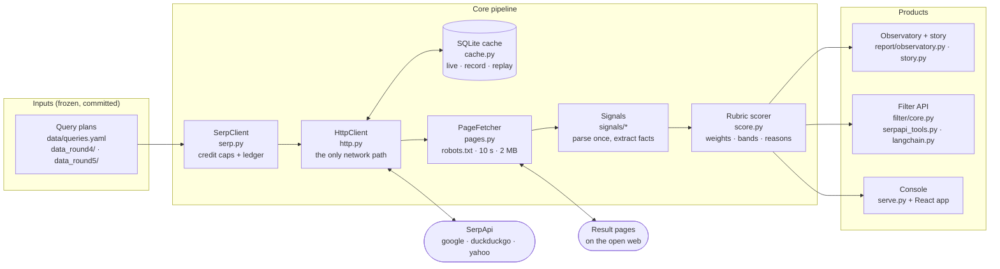
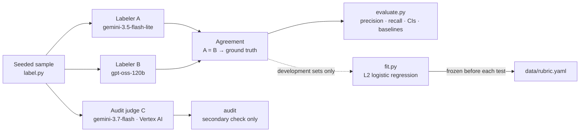
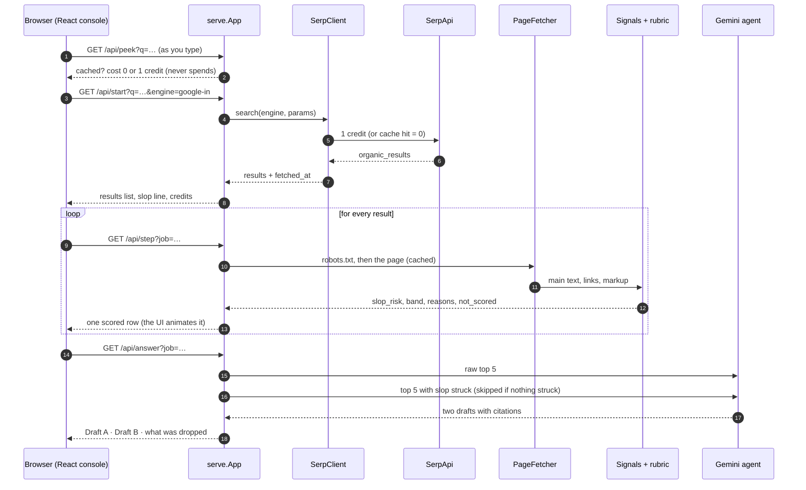
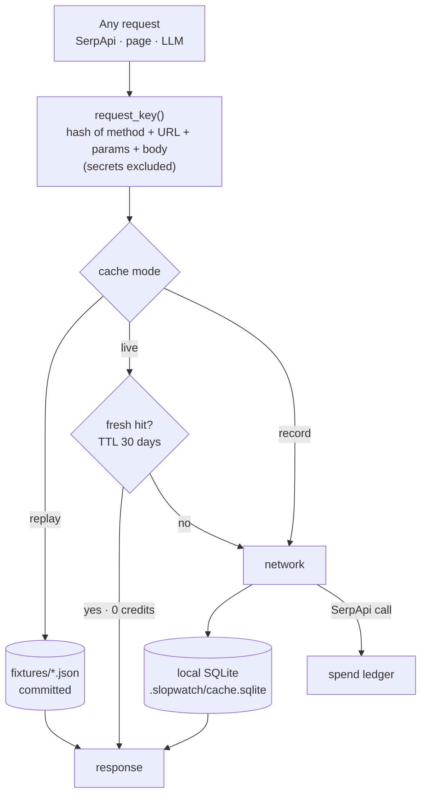
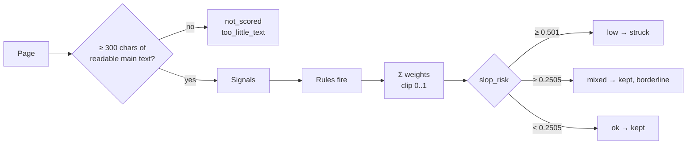
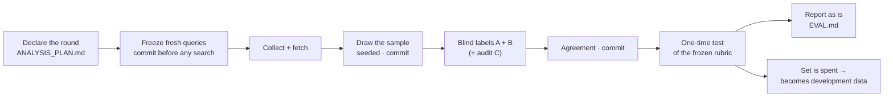
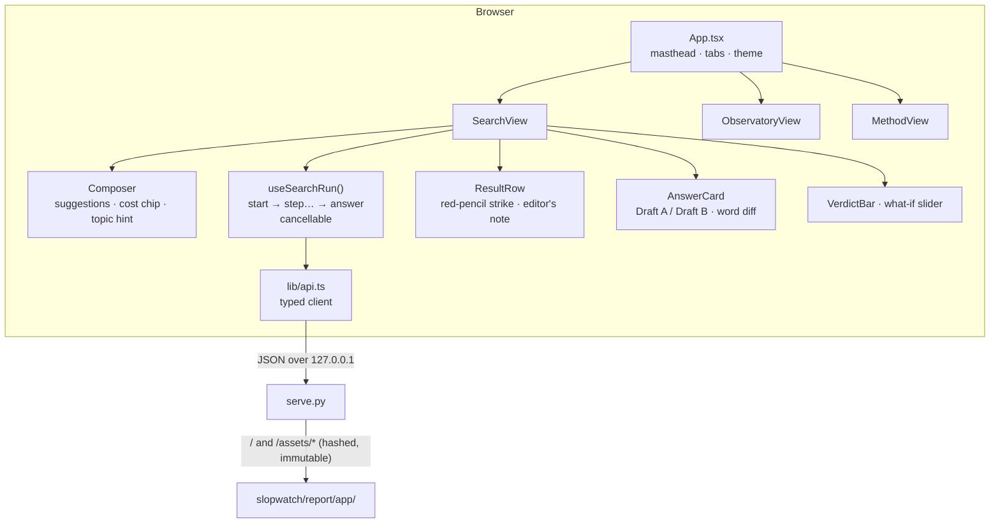

# SlopWatch architecture

How a search result becomes a verdict, and why every number in this repo can be
reproduced. Diagrams are Mermaid (they render on GitHub). File paths are real.

- [1. System at a glance](#1-system-at-a-glance)
- [2. The live request path](#2-the-live-request-path-slopwatch-serve)
- [3. Module map](#3-module-map)
- [4. One HTTP path: cache, fixtures and the credit ledgers](#4-one-http-path-cache-fixtures-and-the-credit-ledgers)
- [5. Scoring: signals → slop risk → verdict](#5-scoring-signals--slop-risk--verdict)
- [6. Validation: how the rubric earns its numbers](#6-validation-how-the-rubric-earns-its-numbers)
- [7. The console (frontend)](#7-the-console-frontend)
- [8. Quality, CI and reproducibility](#8-quality-ci-and-reproducibility)
- [9. Design decisions](#9-design-decisions)
- [10. Extending SlopWatch](#10-extending-slopwatch)

---

## 1. System at a glance

Two products share one core: an **observatory** (measure what Indian searches hand
to AI agents) and a **filter** (remove likely slop before an agent reads it).

Validation runs beside the core and never feeds the score directly:

---

## 2. The live request path (`slopwatch serve`)

The console asks one short question of the server at a time, so a single-threaded
server can stream progress to the page. Everything runs on `127.0.0.1`.

Endpoints (all `GET`, JSON): `/api/peek`, `/api/suggest`, `/api/start`,
`/api/step`, `/api/answer`, `/api/search` (one-shot), `/api/overview`,
`/api/rubric`; `/` and `/assets/*` serve the built React app.

---

## 3. Module map

| Layer | Module | Responsibility |
|---|---|---|
| Entry | `slopwatch/cli.py` | 16 commands: `collect`, `fetch`, `score`, `label`, `llm-label`, `agreement`, `audit`, `evaluate`, `fit`, `filter`, `search`, `serve`, `report`, `demo`, `resignal`, `doctor` |
| Config | `config.py` | Settings from env / `.env`; research cap (180) and live caps |
| Network | `http.py` | The single outbound path: retries, backoff, size caps, secret redaction, redirect-loop guard |
| | `cache.py` | SQLite response cache; `live` (use cache, fetch misses), `record` (always refetch), `replay` (fixtures only) |
| SerpApi | `serp.py` | `SerpClient` with a per-run cap, a project cap and an append-only spend ledger |
| | `queries.py` | Frozen query plans → jobs per engine and locale; the US subset is drawn by seed, not by hand |
| Pages | `pages.py` | Robots-aware fetch (10 s timeout, 2 MB cap); unreadable pages are reported, never guessed |
| | `platform.py` | Video, forum, social, app-store and shop pages are a separate class, never scored |
| Signals | `signals/base.py` | Parse a page once: main text, links, markup, metadata |
| | `signals/authorship.py` | Named author, date, about/contact page |
| | `signals/relevance.py` | Does the page address *this* query? Stemmed word coverage of title and text |
| | `signals/commerce.py` · `affiliate.py` · `ads.py` | Sells on the page, affiliate links, ad/tracker load |
| | `signals/thin.py` · `duplicate.py` · `lists.py` | Text length, near-duplicates, domain lists |
| Scoring | `score.py` | Rubric → `slop_risk` 0–1, band, human-readable reasons |
| | `fit.py` | Fit rule weights on development labels only; writes a frozen rubric |
| Validation | `label.py` · `llm_label.py` | Seeded samples; blind LLM labelers A, B and audit judge C |
| | `evaluate.py` · `stats.py` | Precision/recall/F1, Wilson and bootstrap intervals, kappa, baselines, Rogan-Gladen |
| | `measure.py` | Observatory shares with honest uncertainty and coverage bounds |
| Products | `filter/core.py` | `SlopFilter`: annotate or drop; offline or live |
| | `filter/serpapi_tools.py` · `filter/langchain.py` | Drop-in for SerpApi's agent tooling (14 frameworks) and LangChain |
| | `serve.py` | Local console API |
| | `report/observatory.py` · `report/story.py` · `demo.py` | Reports and the agent before/after |
| Frontend | `web/src/**` | React 19 + TypeScript console; built into `slopwatch/report/app/` |

---

## 4. One HTTP path: cache, fixtures and the credit ledgers

Every request in the project, SerpApi, web pages and LLMs alike, goes through
`HttpClient`, and every response through one SQLite cache. That single choke point
is what makes the project auditable and reproducible.

| Ledger | File | Committed? | Cap | Counts |
|---|---|---|---|---|
| Research | `data/serpapi_ledger.jsonl` | yes | **180** (hard, in code) | the measurement and the held-out tests: 174 used |
| Live | `.slopwatch/live_ledger.jsonl` | no | per session (`serve --max-credits`, default 50) | your own questions in the console / `search` |

- **What is committed:** every SerpApi and LLM response (as fixtures), page hashes,
  fetch metadata, excerpts of at most 300 characters and derived signals.
- **What is not:** page HTML (third-party content) and keys. A fresh clone replays
  the whole analysis with **no key and no network**.
- `record` mode always refetches (and re-spends); `live` mode reuses the cache.
  This distinction is documented in the CLI help because it once cost 9 credits.

---

## 5. Scoring: signals → slop risk → verdict

A page's **slop risk** is the sum of the weights of the rules it triggers, clipped
to 0–1. No model reads the page at scoring time; the rules are data
(`data/rubric.yaml`, version 4, frozen).

| Rule | Fires when | Weight (v4) |
|---|---|---|
| `text_off_query` | main text covers < 60% of the query's words | **+0.282** |
| `sells_directly` | the site sells on the page (cart, buy button, product markup) | **+0.233** |
| `title_off_query` | title and headings cover < 50% of the query's words | **+0.209** |
| `no_author` | no named author | **+0.158** |
| `anonymous` | no author **and** no date | **+0.118** |
| `no_about_contact` | no about or contact page linked | −0.031 |
| `affiliate_present` | one or more affiliate links | −0.042 |
| `listicle` | "best X" listicle pattern | −0.070 |
| `thin` | main text under 1,500 characters | −0.117 |
| `official_source` | government, education or the organisation's own help pages | −0.130 |

Weights came from L2 logistic regression on 257 development items (5-fold
cross-validated precision 0.80). Negative weights are **protective**: on Indian
data, affiliate links and listicles did *not* predict slop. Every verdict carries
its reasons, e.g. `0.65 low: no named author · title and headings cover 20% of the
query's words`. Platform pages and pages that cannot be fetched are never dropped;
they are marked `not_scored` with the cause.

---

## 6. Validation: how the rubric earns its numbers

No human labels. Two LLMs label each sampled page **blind** (they never see scores
or signals); only pages both agree on count. Every test set is declared in
[ANALYSIS_PLAN.md](ANALYSIS_PLAN.md) **before** it is searched, and is used once.

| Round | Rubric | Test set | Precision [95% CI] | Outcome |
|---|---|---|---|---|
| 2 | v2 | 71 items | 0.37 [0.19, 0.59] | failed, rebuilt |
| 3 | v3 | 114 items, fresh pages | 0.57 [0.25, 0.84] | failed the 0.70 gate |
| **4** | **v4** | **102 items, 30 new queries** | **0.88 [0.53, 0.98]** | **passed** |
| 5 | v4 unchanged | 83 items, 4 new topics | 0.56 [0.27, 0.81] | failed out of domain |
| audit | v4 vs judge C | rounds 4 and 5 | 0.89 / 0.56 | confirms 92% / 83% of labels |

Details, baselines and every error: [EVAL.md](EVAL.md). Protocol: [LABELING.md](LABELING.md).

---

## 7. The console (frontend)

React 19 + TypeScript, built with Vite 8, styled with Tailwind CSS 4, accessible
primitives from Radix UI, animation with Motion. It ships **pre-built inside the
Python package**: running it needs no Node and no network (fonts are bundled).

- **Design system:** semantic colour tokens in `web/src/index.css` ("paper and
  ink"); data colours (pine = clear, terracotta = slop) validated for contrast and
  red-green colour blindness in both themes.
- **Honest UI:** the cost chip comes from a real cache check; cached searches show
  their SerpApi snapshot date; the what-if slider never changes the agent
  comparison, which always uses the frozen line.
- **Develop:** `cd web && npm install && npm run dev` (proxies `/api` to a running
  `slopwatch serve`), then `npm run build`.

---

## 8. Quality, CI and reproducibility

| | |
|---|---|
| Tests | **267** pytest tests, offline (no keys, no network); coverage gate 80%, actual ~94% |
| Static checks | `ruff check`, `ruff format --check`, `mypy` (strict on the package) |
| CI | `.github/workflows/ci.yml`: install → lint → types → tests → rebuild the report from committed data |
| Reproduce | `slopwatch report --cache-mode replay` rebuilds every number from the repo in under 3 minutes |
| Code | ~7,300 lines of Python, ~1,400 of TypeScript, ~3,600 of tests |

---

## 9. Design decisions

| Decision | Why |
|---|---|
| **Deterministic rules, not an AI judge** | Explainable ("struck because…"), cheap, reproducible, and impossible to prompt-inject. AI is used only to *validate*. |
| **One HTTP path + committed fixtures** | Every number is auditable and replayable; credit spend is provable. |
| **Pre-registered, one-time tests** | Stops tuning on the test set. Failures are kept in the record. |
| **Unscored ≠ slop** | Platform pages, blocked and thin pages are reported with their cause, never guessed. Shares are reported with best/worst-case bounds. |
| **Precision over recall** | Wrongly removing a good page costs a user more than missing a bad one. Specificity is 0.99 on round 4. |
| **Ship the UI inside the wheel** | `pip install` gives a working console with no build step and no CDN. |

---

## 10. Extending SlopWatch

**Add a signal** (e.g. the "service seller" signal round 5 called for):
1. Extract it in `slopwatch/signals/` and add the field to `Signals` in `models.py`.
2. Add a candidate rule in `slopwatch/fit.py`; fit on development labels only
   (`slopwatch fit --version 5 --holdout <new set>`).
3. Declare a new round in `ANALYSIS_PLAN.md`, freeze fresh queries, label, and
   test **once**. Report the result whatever it is.

**Use another search engine:** add its locale parameters in `queries.py`
(`LOCALE_PARAMS`) and its query field in `serp.py` (`QUERY_PARAM`).

**Use the filter in your agent:** see the README's *Use it* section; every result
gains `result["slopwatch"] = {slop_risk, band, reasons, not_scored}`.
