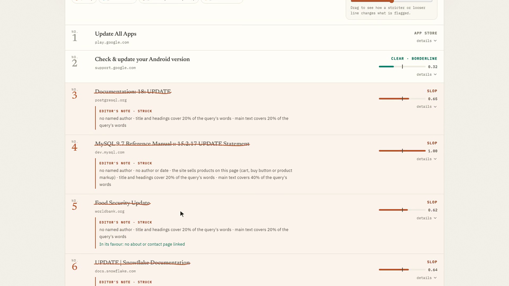
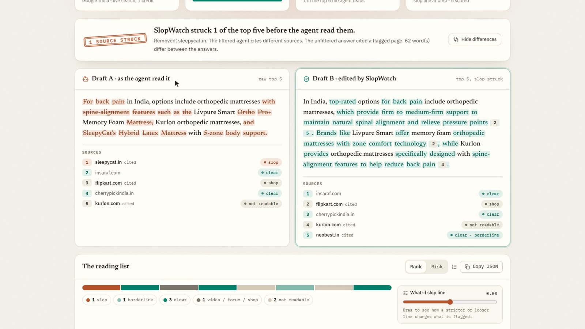
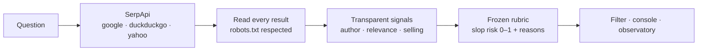

# SlopWatch

[](https://github.com/soujasK/slopwatch/actions/workflows/ci.yml)


[](ARCHITECTURE.md)

> **Don't feed your agent slop.**

SlopWatch checks what AI assistants read from search results for Indian
questions, and removes the junk before they repeat it.



<sub>A live Google India search (via SerpApi, 11 Oct 2026) for *how to update aadhaar
mobile number online*. The top results include the PostgreSQL and MySQL `UPDATE`
manuals. SlopWatch strikes them, with reasons, before an AI agent reads them.</sub>

---

## In 30 seconds

**The problem.** Garbage in, garbage out. AI agents answer from the top search
results and trust them blindly, so a junk page in the results becomes a confident
junk answer. Nobody had measured what those results contain for Indian users, or
given agent builders a quality signal.

**What SlopWatch does**

1. **Measures.** 100 real Indian questions across Google, DuckDuckGo and Yahoo
   (India) and Google US, through SerpApi. Every result page is read and scored,
   and every number comes with a 95% confidence interval.
2. **Filters.** A Python package that gives each result a 0–1 *slop risk* with
   plain reasons and drops likely slop. It is a one-line drop-in for SerpApi's
   official agent tooling (14 frameworks).
3. **Shows it.** A local console: ask anything, watch every page get read and
   scored, and compare the AI's answer with and without SlopWatch.

**Does it change the answer?** Same AI, same live search, before and after:



<sub>*best mattress for back pain india* (live, 11 Oct 2026). With SleepyCat's own shop
page in the sources, the AI repeats its sales copy ("5-zone body support"). With it
struck, the AI explains what helps: firm-to-medium support and spinal alignment.</sub>

### Key results

| | |
|---|---|
| Share of India results with slop signals | **4.5%** [2.2%, 7.2%], about **11%** after correcting for what the filter misses |
| Google India searches answered by an AI Overview first | **39 of 40** |
| Pages that refused automated access | **22%** (14 answered *402 Payment Required*) |
| Precision on a fresh, never-seen test (rubric v4) | **0.88** [0.53, 0.98]; specificity 0.99 |
| Independent audit judge agrees with the labels | **92%** |
| Published failures | v2 (0.37), v3 (0.57), and new topics (0.56) |

---

## Quick start

```bash
pip install "slopwatch[agents] @ git+https://github.com/soujasK/slopwatch"   # Python 3.11+
slopwatch serve                                  # opens the console at http://127.0.0.1:8765
slopwatch report --cache-mode replay             # rebuild every number offline, no key needed
```

Live searches need `SERPAPI_API_KEY` (and `GEMINI_API_KEY` for the agent answers)
in your environment or a `.env` file. Repeated questions come from the cache for free.

## Use it in your agent

**Three lines in any Python code:**

```python
from slopwatch.filter import filter_results
clean = filter_results("best sip to invest in 2026", serp["organic_results"])
# each kept result: result["slopwatch"] = {slop_risk, band, reasons, not_scored}
```

**SerpApi's official agent tooling** (OpenAI Agents SDK, LangChain, LangGraph,
CrewAI, LlamaIndex, Claude Agent SDK, Google ADK and more):

```python
from slopwatch.filter.serpapi_tools import web_search   # instead of serpapi_search_tools
tools = [web_search()]                                    # same tool, slop filtered
```

**LangChain `SerpAPIWrapper`:** `slopwatch.filter.langchain.filtered_results(wrapper, query)`.

Every result keeps its reasons, e.g. `0.65 low: no named author · title and headings
cover 20% of the query's words`. Platform pages (video, forums, shops) and pages that
cannot be fetched are never dropped; they are marked `not_scored` with the cause.

---

## How it works



No AI judges a page: the score is a fixed, weighted set of yes/no rules
(`data/rubric.yaml`). AI is used only to *validate* those rules. Full design, with
diagrams of every layer: **[ARCHITECTURE.md](ARCHITECTURE.md)**.

---

## What we measured (snapshot of 2026-10-03)

100 SerpApi searches: 40 real Indian queries (health, personal finance, product
reviews, tech how-tos) on Google India; 20 locale-neutral ones on DuckDuckGo
India, Yahoo India and Google US. 822 organic results, 681 unique pages, each
fetched once (robots.txt respected) and scored. Every share below is over scored,
non-platform results, with a 95% cluster-bootstrap interval over queries.

| | Share with low-quality signals | n scored | coverage |
|---|---|---|---|
| **India, all engines** | **4.5%** [2.2%, 7.2%] | 426 | 77% |
| Google India | 7.1% [3.3%, 11.7%] | 170 | 75% |
| DuckDuckGo India | 2.7% [0.0%, 5.8%] | 147 | 77% |
| Yahoo India | 2.8% [0.0%, 6.9%] | 109 | 81% |
| Google US (locale-neutral queries) | 15.6% [6.3%, 25.4%] | 64 | 61% |
| Google India (same queries) | 6.6% [1.3%, 13.5%] | 76 | 73% |

Scored with rubric v4. If every unscored India result were ok the share would be
3.4%; if every one were low, 27%. Because the filter catches only about three in
ten low-quality pages, 4.5% understates what the LLM judges would call low;
corrected for the error rates measured on the round-4 test (Rogan-Gladen) it is
about 11%, a very uncertain estimate (recall was measured on only 23 low pages).
Paired comparisons on the same queries (19 pairs each) found **no statistically
detectable difference** between Google India and DuckDuckGo/Yahoo India, or
between Google India and Google US (India − US: −9.3 points, 95% CI −24.2 to
+3.9, p = 0.24).

**Findings**

1. **Indian "slop" is not classic affiliate spam.** Affiliate links and "best X"
   listicles did *not* predict low quality here (their fitted weights are
   negative). What did: **no named author**, **pages that do not address the
   query** (a UN climate report ranking for "best 1.5 ton inverter AC"; dictionary
   definitions and a US research program called "IMPROVE" in the top 5 for "how to
   improve cibil score fast"), and **sellers' own content** (pharmacy and product
   pages).
2. **Google shows an AI Overview on 59 of 60 searches** (39/40 India, 20/20 US),
   and fills 30% of its India top results with platform pages (YouTube, Reddit,
   Quora, shops) against 3–4% on DuckDuckGo and Yahoo.
3. **The web is closing to crawlers:** 22% of pages refused us (403s, robots.txt)
   and 14 answered *402 Payment Required* (pay-per-crawl). US publishers block
   more (61% coverage vs ~77% for India).
4. **Low-band pages appear at every rank** on Google India, including the top
   result (5%, n = 22); no rank stands out (0–12%, small n per rank).

Live searches after the measurement (10–11 Oct 2026, demo sweeps, not part of the
statistics above) found the same patterns: database manuals for an Aadhaar
question, a bus company for "best mixer grinder brand", and brands' own shop pages
quoted as advice for smartwatches and mattresses.

---

## Validation (labels from two LLMs, not humans)

We report the whole history, including what failed (details: [EVAL.md](EVAL.md),
[ANALYSIS_PLAN.md](ANALYSIS_PLAN.md), [LABELING.md](LABELING.md)).

- **Ground truth:** two LLMs (Google `gemini-3.5-flash-lite`, Cloudflare
  `gpt-oss-120b`) label each result blind (never seeing scores or signals); only
  items where both agree count. **No human validation.**
- **Every test set is declared before it is searched and used once.**

| Round | Rubric | Test | Precision [95% CI] | Recall | Outcome |
|---|---|---|---|---|---|
| 2 | v2 | 71 items | 0.37 [0.19, 0.59] | 0.35 | failed; set retired |
| 3 | v3 | 114 items, 150 fresh pages | 0.57 [0.25, 0.84] | 0.19 | failed the 0.70 gate; beat every baseline |
| **4** | **v4** | **102 items, 30 new queries** | **0.88 [0.53, 0.98]** | **0.30** | **passed**; specificity 0.99 |
| 5 | v4, unchanged | 83 items, 4 new topics | 0.56 [0.27, 0.81] | 0.25 | failed out of domain |
| audit | judge `gemini-3.7-flash` | rounds 4 and 5 | 0.89 / 0.56 | | confirms 92% / 83% of labels |

Round 4's interval is wide (8 pages flagged), and the one-line baseline "no author
and no date" reached a slightly higher F1 (0.47 vs 0.45), so that pre-registered
criterion was **not** met. Round 5's main miss: pages selling legal or document
services, which the "sells directly" signal (built for shop carts) does not see.

The filter is conservative: it almost never removes a page the judges called ok
(1 of 79), but it catches only about three in ten low-quality pages. Treat a drop
as "probably not a source to ground on", not as a verdict on a site.

---

## Documentation

| Document | What's in it |
|---|---|
| [ARCHITECTURE.md](ARCHITECTURE.md) | System design, request flow, caching and ledgers, scoring, validation protocol, frontend (with diagrams) |
| [EVAL.md](EVAL.md) | Every test, confusion matrices, baselines, largest errors, the audit |
| [ANALYSIS_PLAN.md](ANALYSIS_PLAN.md) | Pre-registered decisions, dated, before each test |
| [LABELING.md](LABELING.md) | The labeler guide (verbatim) and protocol |
| [LIMITATIONS.md](LIMITATIONS.md) | What this does not show |
| [SERPAPI_USAGE.md](SERPAPI_USAGE.md) | Engines, parameters and every credit spent |
| [DEMO.md](DEMO.md) · [DEMO_RESULTS.md](DEMO_RESULTS.md) | Demo script; pre-registered agent before/after (all 8 reported) |
| [report/story.html](report/story.html) · [report/observatory.html](report/observatory.html) | The narrative page and the full observatory report |

## How it uses SerpApi

SerpApi is both the data source and the integration target:

- **Data:** the `google`, `duckduckgo` and `yahoo` engines with India and US locales.
  That's 100 searches for the measurement plus 62 for two held-out tests
  ([SERPAPI_USAGE.md](SERPAPI_USAGE.md): engines, parameters, credits per stage).
- **Integration:** `SlopWatchClient` plugs into `serpapi-search-tools`, so
  filtering happens inside SerpApi's own agent tools. A live `search` command and
  the console use SerpApi directly.
- **Accountability:** a hard research credit cap (180) is enforced against a
  committed ledger; 174 were spent (100 measurement, 30 round-4 test, 32 round-5
  test, 9 wasted by a re-run in `record` mode, plus probes; 3 on Bing, which
  returned unusable India results). Live questions (`serve`, `search`) use your own
  key and a separate local ledger; `serve` allows 50 new searches per session by
  default (`--max-credits` to change).

## Reproduce

```bash
git clone https://github.com/soujasK/slopwatch && cd slopwatch
pip install -e ".[dev]"
slopwatch report --cache-mode replay     # no API key, no network, < 3 minutes
pytest                                   # 267 offline tests; >= 80% coverage enforced
```

`collect` replays from the committed SerpApi fixtures byte-for-byte. Page HTML is
deliberately not committed (third-party content), so `fetch` needs the network;
everything downstream (`score`, `evaluate`, `report`, `filter --offline`, `demo`)
replays from committed data.

**CLI reference**

```bash
slopwatch serve                                                # local console
slopwatch search "is it safe to take dolo 650 every day"      # live: SerpApi + filter
slopwatch filter --serp-json results.json --threshold 0.6      # pipe-friendly
slopwatch report --cache-mode replay                           # rebuild the observatory
slopwatch demo --cache-mode replay                             # agent before/after
slopwatch doctor                                               # key, cache, credits
```

**The console** is a React 19 + TypeScript app (Vite, Tailwind CSS 4, Radix UI,
Motion) in [`web/`](web/). Its production build ships inside the package, so it
needs no Node and no network. To change it: `cd web && npm install && npm run dev`,
then `npm run build`.

## Prior art

- Bevendorff, Wiegmann, Potthast, Stein, *Is Google Getting Worse? A Longitudinal
  Investigation of SEO Spam in Search Engines*, ECIR 2024 (product reviews, DE/US;
  Google, Bing, DuckDuckGo).
- Work on LLM search agents trusting manipulated or low-quality pages (e.g.
  arXiv 2606.16821, 2605.29224, 2509.23694).
- Domain reliability ratings licensed to AI providers (NewsGuard); manual
  include/exclude domain lists in search APIs (Tavily, Exa); Marginalia's
  affiliate/tracking filters in its own index; site-quality SEO tools.

SlopWatch differs by scoring **individual results for a given query**, with
explainable deterministic signals, **validated** against held-out labels, measured
on **Indian queries**, and shipped as a filter inside SerpApi's agent tooling.

## Ethics

- No copies of third-party pages are published; the repo holds SERP data, page
  hashes, fetch metadata, excerpts of at most 300 characters and derived signals.
  The two screenshots above are of SlopWatch's own interface.
- robots.txt is respected; disallowed or unreachable pages are reported as
  unscored and never fetched. The crawler identifies itself with a contact URL.
- Aggregates only. No per-site "spam" list; examples show only which signals fired.

## Disclosures (required by the hackathon)

- **Pre-existing code:** the HTTP cache, HTTP client, SerpApi client and
  robots-aware page fetcher were adapted from the author's earlier project
  *Zero Hour*; everything else was built for this hackathon (see git history).
- **AI tools:** development assisted by Claude Code. Google Gemini
  (`gemini-3.5-flash-lite`) and Cloudflare Workers AI (`gpt-oss-120b`) were used
  only as blind labelers for validation; `gemini-3.7-flash` on Google Cloud Vertex
  AI as an independent audit judge; and Gemini to play the agent in the demo. No
  LLM is used in scoring.

MIT License.
